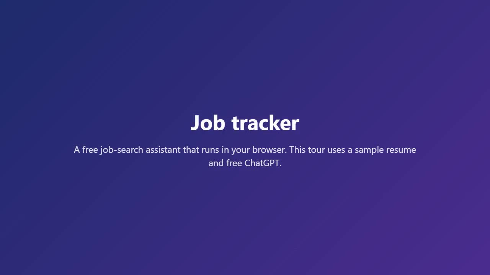

# Job tracker in your browser

Job tracker as one web page, hosted for free on GitHub Pages: nothing to install, no server, no account.

**Open it:** once GitHub Pages is on (see [Publishing](#publishing-for-the-repository-owner)), the site is at
`https://<your-github-name>.github.io/<repository-name>/`.

[](guide/tutorial.mp4)

**[Watch the five-minute tour](guide/tutorial.mp4)**: every feature, with a made-up sample resume and free ChatGPT.
In the app it's the **Watch the tour** button at the top of every page.

Chrome and Edge work best; Firefox and Safari work too. The How to use guide (the **How to use** button) walks through
every step, with the tour at the top.

## How it works

- The site is a single static page (`index.html`). There is no server behind it: everything you add is kept
  in this browser, on this computer: your tracker, resumes, documents, research and settings. Use the same
  browser each time. Clearing your browsing data clears Job tracker too, so download a backup now and then
  (**Settings**, **Local files**, **Back up everything**).
- Your tracker is an Excel file. Open it with **Open a tracker file**. In Chrome and Edge, Job tracker stays
  linked to the file and saves every change straight into it, with its formats, dropdowns and formulas.
  In other browsers, a bar reminds you to download the updated tracker after making changes.
- Two ways to draft: free chat (copy and paste into ChatGPT or Claude) or a local model.
  A local model in LM Studio can also search the web for Find jobs (see below). Paid API keys, the automatic
  job finder and the link check need a server, so they aren't part of this site.
- Cover letters and resumes are made as Word files and PDFs and kept with each job. Download them,
  or use **Open folder** on a job to see everything kept for it.
- In Chrome and Edge you can also save your files to a folder on your computer: on the **Resume** tab,
  press **Choose folder**. Job tracker makes three folders in it: Job tracker files (saved there as
  you work), Custom resumes and Cover letters (each as a Word file and a PDF). The browser asks
  again on a later visit before Job tracker can write to it.
- The first time you open a spreadsheet, a Word file or a PDF, the page loads the tools it needs from
  a public code library (cdnjs.cloudflare.com and cdn.jsdelivr.net). Your files aren't sent there.

## Using a local model (Ollama or LM Studio)

The site is served over HTTPS from `https://<your-github-name>.github.io`, and your model runs on your own computer.
(Settings, **Local model**, shows the exact address to use.)
The model has to allow this site to talk to it, and the browser asks you once to allow it too:
Chrome and Edge show **"… wants to access other apps and services on this device"** (or **devices on your local
network**). Click **Allow**. If you clicked Block, use the icon at the left of the address bar to change it.

### Ollama

1. Quit Ollama.
2. Set the environment variable `OLLAMA_ORIGINS` to the site's address, then start Ollama again.
   - Windows: `setx OLLAMA_ORIGINS "https://<your-github-name>.github.io"`
   - macOS: `launchctl setenv OLLAMA_ORIGINS "https://<your-github-name>.github.io"`
   - Linux: add `Environment="OLLAMA_ORIGINS=https://<your-github-name>.github.io"` to the ollama service, then restart it
3. In Job tracker: **Settings**, **Drafting with**, **Local model**. Server address `http://localhost:11434/v1`,
   the model you pulled (for example `llama3.1:8b`), then **Test connection**.

### LM Studio

1. In the Developer tab (the server), start the server and switch on **Enable CORS**.
2. In Job tracker: server address `http://localhost:1234/v1` and the model name, then **Test connection**.
   If LM Studio runs on another computer, use that computer's address, for example `http://192.168.2.132:1234/v1`,
   and switch on **Serve on Local Network** in LM Studio. Because the site is HTTPS and LM Studio is plain HTTP,
   a model on another computer only works in Chrome and Edge (after you allow local network access);
   other browsers block it. A model on the same computer (`localhost`) works in every browser.

### Web search for Find jobs (LM Studio 0.4 or newer)

A local model can't go online by itself. LM Studio can give it a web search plugin (an MCP server) that runs
on the computer where LM Studio is. Then **Find jobs**, **AI search** sends your search to the model, the
model searches the web, and the results come back in your tracker's columns.

Everything is done in LM Studio's own window, on the computer that runs it:

1. In a chat, open the **Program** tab on the right, then **Install**, **Edit mcp.json**, and add a web
   search server. Exa's hosted one needs nothing installed and no key (free, with a usage limit):

   ```json
   {
     "mcpServers": {
       "exa": {
         "url": "https://mcp.exa.ai/mcp"
       }
     }
   }
   ```

   If mcp.json already lists other servers, add the `"exa"` entry next to them.
2. In the Developer tab's **Server Settings**, switch on **Allow calling servers from mcp.json**.
3. Use a model that is good with tools (Qwen 3 or newer, gpt-oss, GLM 4.7 and the like).

The searches the model writes go to Exa; your resume stays with your model.

In Job tracker: **Settings**, **Local model**, **Web search plugin**: `exa` (the name from mcp.json).
Then in **Find jobs**, pick **AI search**. A search can take several minutes. Job tracker refuses results
when the model didn't search at all, and it removes any link that wasn't in the search results, so you
aren't sent to a page the model made up. Still check each posting before you apply.

## Privacy

Prompts for a chat website have your name, email, phone, address and links replaced with placeholders,
which are put back when you paste the reply. Nothing else leaves this page, except what you send to
your own local model. GitHub serves the page but never sees what you put into it.

Browsers keep a site's saved data by its address, and every GitHub Pages site of the same account shares
`<your-github-name>.github.io`. Only publish pages you trust under that account.

## Publishing (for the repository owner)

GitHub Pages is free for public repositories, so everything in this repository is public: never commit
real resumes, trackers or personal details. The guide screenshots use made-up data.

1. On GitHub: **Settings**, **Pages**, **Build and deployment**, Source **Deploy from a branch**,
   then pick the branch and the **/ (root)** folder, and **Save**.
2. A minute or two later the site is at `https://<your-github-name>.github.io/<repository-name>/`. Every push to that
   branch publishes again.

`.nojekyll` tells GitHub Pages to serve the files as they are. There is no build step: `index.html` is the app.
To try a change before pushing, serve this folder from any local web server, for example
`python -m http.server 8770`, and open http://localhost:8770/.
